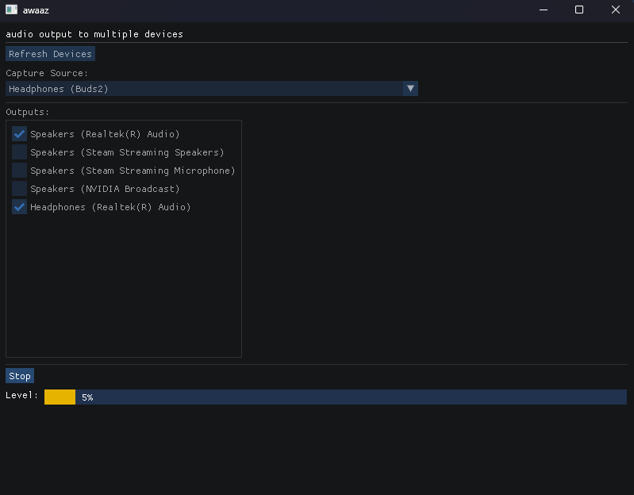

# awaaz - output audio to multiple devices

## Build
- Clone the repo (with submodules):
    - `git clone https://github.com/s1as3r/awaaz.git --recurse-submodules`
- Build
    - Windows
        - assumnes msvc is available - might want to use the developer powershell for this
        - `./build.ps1`
    - Linux
        - assumes clang is available
        - `./build.sh`
- Run
    - the app will be at `./build/awaaz.exe` | `./build/awaaz`
